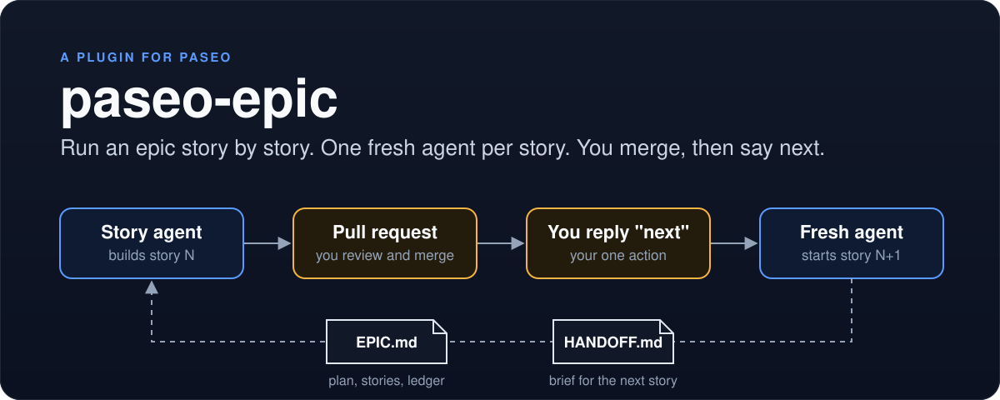

<p align="center"></p>

Run an epic story by story in [Paseo](https://paseo.sh): one fresh agent per story, one merge and one word from you between stories.

**Status:** v0.1 · needs Paseo >= 0.12.0 · MIT license · built for a single user on one daemon.

## What it is

`paseo-epic` is a native Paseo plugin (plugin id `epic`). It runs an epic, an
ordered list of user stories, one story at a time on one epic branch. Every
story gets a fresh agent in its own worktree. The human gate is the pull
request merge: you merge the story PR, then reply `next`, and the plugin
starts the agent for the next story. Two files in your repo carry all the
state: `EPIC.md` (the plan and the history) and `HANDOFF.md` (the brief for
the next story).

## Why

Without a routine, a long epic goes wrong in the same few ways:

- **Context rot.** One agent session that runs story after story fills up
  with old detail. Its later work gets worse.
- **Stale plans.** The plan for story 3 was written before story 2 shipped.
  Nobody updates it with what story 2 actually built, changed, or skipped.
- **Retyped context.** You start each new session by explaining the epic
  again, by hand, from memory.

What the plugin gives you:

- **A handoff at every close.** The agent that built the story writes
  `HANDOFF.md` while it still knows the details: what shipped, what changed
  in the plan, the brief for the next story, and the traps it found.
- **A fresh agent per story.** It starts from the merged handoff, not from a
  long chat history.
- **Flow guards.** `start` and `next` read the handoff from the pushed epic
  branch and refuse when the flow cannot go on: a dirty tree, an epic branch
  that is not pushed, a handoff that names another story, a story that is
  not merged yet, or another story PR still open (checked when `gh` is
  installed). `close` refuses off the story branch, with stray changes, or
  when the handoff does not say `after=<story>` or still says `next=<story>`.
- **Your rules stay yours.** The plugin checks no story ids and no file
  content. Your repo keeps its own rules and names them in `.epic.yml`
  hooks; the plugin quotes them to the agent at the right moment.
- **One human touch per story.** You merge the PR and reply `next`.
  Everything else is the agent's job or the plugin's job.

## How it works

```
  epic_init --> plan stories --> epic_start --> build --> epic_close
                                     ^                        |
                                     |                        v
                        fresh agent, new worktree       story PR opened
                                     ^                        |
                                     |                        v
                               reply "next" <------------ you merge
```

At close, the agent follows your close steps (for example: update the story
row and the ledger in `EPIC.md`, rewrite `HANDOFF.md`, run your repo's
check). `epic_close` commits, pushes, and opens the story PR into the epic
branch. After you merge and reply `next`, the plugin creates a worktree on a
new story branch and starts an agent there. Its first prompt tells it to
call `epic_start`, then lists the merged PR's conversation comments.

Three kinds of caller use the plugin:

| Caller | What it uses |
| --- | --- |
| You (human) | The **Epic** header button in each workspace of an epic repo, the **Epic** panel (in the workspace or the Explorer; it also opens the story's workspace and agent), the **Epics** screen from the sidebar, the `/epic <verb> [id]` slash command, and the Command Center item **Epic: start next story** |
| The agent | The five `epic_*` tools of the `epic` MCP server |
| The plugin itself | An `agent.create` hook that adds the `epic` MCP server to new agents in a repo with `.epic.yml` or an epic package, and an `agent.turn_ended` hook that spawns the next story's agent after `epic_next` |

> [!IMPORTANT]
> This plugin is for **one person running one epic on one daemon**. One story
> is in flight at a time, one agent builds it, one human merges. There are no
> locks, no assignments, and no per-member state. Do not share one epic
> between several people.

## Install

You need Paseo 0.12.0 or newer.

From GitHub. Paseo runs the build step from `paseo-plugin.json`
(`npm ci --omit=dev`):

```bash
paseo plugin install github:thanh-dong/paseo-epic
```

From a local clone. A local-path install does not run the build step, and
the server bundle needs `yaml` from the clone's `node_modules`, so install
the dependencies first:

```bash
cd /absolute/path/to/paseo-epic
npm ci --omit=dev
paseo plugin install /absolute/path/to/paseo-epic
```

Check that it runs:

```bash
paseo plugin ls          # epic must show `running`
paseo plugin logs epic   # no errors
```

A `paseo` CLI older than 0.10 has no `paseo plugin` command. Run the 0.12.0
CLI through `npx` instead of a global upgrade:

```bash
npx -y @getpaseo/cli@0.12.0 plugin install github:thanh-dong/paseo-epic
```

### Enable plugins

The daemon runs plugins only when `pluginsEnabled` is `true`. A missing key
counts as `false`. Turn it on in the Paseo app (**Settings → Plugins → Enable
plugins**), or set the root key `"pluginsEnabled": true` in the daemon's
`config.json` and run `paseo reload --json`.

Read Paseo's warning before you do this:

> Plugins are trusted, unsandboxed code. Backend plugin code can access your
> daemon machine, including files, processes, credentials, and network
> services. Client plugin code runs inside the Paseo app.

Install only plugins whose source you have read.

The MCP server runs under plain `node`. The plugin uses `PASEO_EPIC_NODE`
when it is set in the daemon's environment, else `node` on `PATH`, else the
daemon's own executable with `ELECTRON_RUN_AS_NODE=1`. The `gh` CLI is
optional: without it, the plugin does not open PRs or read PR comments, and
it gives you the commands to run by hand.

## Quick start

1. **Init.** A planning agent calls `epic_init` with an epic id and a title,
   once the repo has `.epic.yml`. It checks out `epic/<epic>-<slug>` and
   writes `EPIC.md` and `HANDOFF.md` under `docs/stories/epics/<epic>-<slug>/`.
2. **Plan.** The agent fills in the story table and the first handoff (its
   header says `next=<first story>`), follows your `hooks.init` lines, then
   commits and pushes the epic branch; `start` reads the handoff from
   `origin`.
3. **Start.** A fresh agent calls `epic_start`. It cuts
   `feat/<story>-<slug>` from the epic tip and returns the handoff, your
   `hooks.start` lines, and the close steps.
4. **Build.** The agent builds the story as an ordinary task, in any way you
   like. The plugin adds no method.
5. **Close.** The agent follows the close steps (your `hooks.close` lines),
   writes the handoff for the next story, then calls `epic_close`.
6. **Merge.** Review and merge the story PR on GitHub.
7. **Next.** Reply `next` to the closing agent, or press **Start next story**.
   A fresh agent starts the next story in a new worktree.

Ids are yours. The plugin takes any story id shape (`TH-1`, `TH-E10-1`,
`story-7`, `ABC`). The epic id is the package folder name before the first
`-`, so it cannot hold a `-`.

## Usage reference

### Where to find it

| Place | What you get |
| --- | --- |
| Workspace header | In every workspace of a repo with `.epic.yml` or an epic package, a button with where the epic stands: `E10 · next TH-E10-3`, `E10 · closed` when the handoff says `next=none`, or `Epic` before the first package. Its menu: **Open Epic panel**, **Open in Explorer**, **Epic overview**. No item starts work. |
| Explorer | The Epic panel can also open in the Explorer side panel. |
| Sidebar footer | **Epics** opens the Epics screen: the epics of all projects on the host. |
| Composer | `/epic status` opens the Epic panel. |

The header label is read when the button appears and again each time Paseo
updates that workspace. The `next` in the label comes from the handoff on
`origin/<epic branch>` as last fetched, else from the checkout.

### The `/epic` slash command

For you, in the Paseo composer. Agents use the `epic_*` tools instead.

| Verb | What it does |
| --- | --- |
| `init` | Same as `epic_init`. |
| `start` | Sends the newest open agent in the workspace the prompt to call `epic_start`. |
| `close` | Sends the newest open agent the prompt to call `epic_close`. |
| `next` | Confirms the merge and spawns the next story's agent. Same action as the panel button. |
| `status` | Opens the Epic panel. |

### Agent tools

The plugin adds the `epic` MCP server to a new agent when the agent's repo
root has `.epic.yml`, or already has an epic package (an `EPIC.md` with the
`<!-- epic-status:begin -->` marker under `epicsDir`). With `.epic.yml` alone,
the agent can start the first epic with `epic_init`. A broken `.epic.yml`
gives no tools, and the plugin log says why.

> [!NOTE]
> The tools are added only when an agent is created. An agent created before
> the repo had `.epic.yml` (or before the plugin was installed) never gets
> them, even though the plugin is running. Start a new agent in that
> workspace.

Each answer is the result as JSON, then a short "what to do now" paragraph.
A refusal is an error result with one sentence that says what to do next.

| Tool | Input | Returns |
| --- | --- | --- |
| `epic_init` | `epic`, `title` | Checks out the epic branch and writes `EPIC.md` and `HANDOFF.md`, then quotes the `hooks.init` lines. Refuses an epic id with `-`, `/`, `\` or spaces, an existing `EPIC.md`, or a dirty tree. |
| `epic_status` | none | The epic package: state, story rows, next story. With no epic yet, says to call `epic_init`. |
| `epic_start` | `story` | Cuts the story branch from the epic tip; returns the handoff, the `hooks.start` lines, and the close steps (`hooks.close`, then the `epic_close` call). |
| `epic_close` | `story` | Commits the epic folder, pushes, opens the story PR (and a draft epic PR when the handoff says `next=none`). |
| `epic_next` | `story` (the closed story) | Confirms the merge and names the next story. The plugin then spawns it. |

### The Epic panel

The panel shows the epic, its branch, how many commits it is behind the base
branch, the story table, the next story, and the open PR with its link. It
has one button: **Start next story**. It reads the package when it opens,
after a button press, and after a slash command result. It does not refresh
on a timer.

Each story row opens and closes when you press it. A chevron shows whether
it is open. A colored dot shows the status: the accent color for
`in_progress`, the normal text color for `implemented`, and the muted color
for `planned` and `dropped`. The first time the panel shows an epic, the
`in_progress` row starts open; when no row is in progress, the next story's
row does.

An open row shows, from top to bottom:

- **Refresh**: reads the row again.
- `workspace <name>` and an **Open workspace** button.
- `agent <title> (<status>)` and an **Open agent** button.
- `PR` and the story PR as a link, for example `#296 (open)`. When the app
  cannot open links, the number and the URL show as text. Without a PR, the
  row's Done text, or `none yet`.
- `changes vs <base>: <n> files, <m> uncommitted`, then one line per file:
  the status letter (`A`, `M`, `D` or `R`), the path, and an `uncommitted`
  tag when the change is not committed yet. Paths are selectable text.
- A note when the plugin finds no workspace for the story, or more than one.

The buttons appear only when your Paseo app supports navigation from a
panel; older apps show the names as text.

The panel lists the epics in its own checkout, so open it in a workspace on
the epic branch or on one of its story branches, or in the story's worktree.

The panel looks in its own Paseo project for the workspace and the agent,
and asks `gh` for the PR:

- The workspace whose current branch is the story branch
  (`<branchPrefix><story>-...`). When the panel's own workspace is on that
  branch, it wins.
- The newest open agent with the label `epic.story` set to the story; else
  the newest open agent whose working directory is in that workspace.
- The PR through `gh`: the open PR into the epic branch first; for an
  `implemented` row, the merged one. Without `gh` there is no PR link.

The file list is read in the story's worktree, not in the panel's checkout.
It holds the files committed since the story branch left the epic branch
(`git diff --name-status origin/<epic>...HEAD`) plus the uncommitted and
untracked files (`git status --porcelain --untracked-files=all`). The panel
does not fetch, so `origin/<epic>` is the epic branch as last fetched. A row
loads the first time you open it and again when you press **Refresh**; it
does not refresh on a timer. Errors show inside the open row.

Review flow: open the Epic panel in a workspace whose checkout holds the epic
package (see above), open the story's row, press **Open workspace**, and
review the change in Paseo's Diff tab.

### The Epics screen

The screen lists the epics of every git project on the host, one section per
project and one card per epic, newest epic first. It reads each epic from its
epic branch on origin (`origin/<epicBranchPrefix>*`, as last fetched), so
every worktree sees the same state. A card shows:

- the epic id and title, the `State:` line, and the next story;
- `stories: <open> of <total> open` (rows whose status is `planned` or
  `in_progress`);
- the open PR into the epic branch, through `gh` (`PR: none` without one or
  without `gh`);
- **Open workspace** and **Open panel**, for a workspace of the project on
  the epic branch, on one of its story branches, or at the project root.

**Refresh** runs `git fetch origin --prune` in every project, then reads
them again. Opening the screen does not fetch. Epics whose handoff says
`next=none` are hidden until you turn on **Show closed**. A project with no
epic branch is not shown. When one project fails, its error shows in its own
section; the other projects still show.

### `.epic.yml`

An optional file at the repo root. The schema is strict: an unknown key, a
wrong type, or bad YAML is an error. **The plugin never runs commands from
this file. It only reads the values and quotes the hook text to agents.**

| Field | Default | What it does |
| --- | --- | --- |
| `epicsDir` | `docs/stories/epics` | Folder with one folder per epic package. Epic detection looks here. |
| `templates` | none (shipped templates) | Folder with your own `epic.md` and `handoff.md` for `init`. |
| `branchPrefix` | `feat/` | Story branches are `<branchPrefix><story>-<slug>`. |
| `epicBranchPrefix` | `epic/` | The epic branch is `<epicBranchPrefix><epic folder>`. |
| `baseBranch` | `main` | `init` cuts the epic branch from `origin/<baseBranch>`; the draft epic PR targets it. |
| `profile` | none | Paseo launch profile for successor agents, by id or name. |
| `hooks.init` | `[]` | Lines quoted after `epic_init`. |
| `hooks.start` | `[]` | Lines added to the text after `epic_start`. |
| `hooks.close` | `[]` | The close steps, quoted by `epic_start` under "When the story is done:". |
| `hooks.nextPrompt` | none | Text appended to the successor agent's first prompt. |

Full example and error behavior: [docs/epic-yml.md](docs/epic-yml.md).

## Files the plugin owns in your repo

Each epic package is one folder, `<epicsDir>/<epic>-<slug>/`, with two files.
The plugin reads the parts below and checks none of them. Comment blocks
(`<!-- -->`) are skipped.

**`EPIC.md`** holds the plan and the history:

- A **Status** block between `<!-- epic-status:begin -->` and
  `<!-- epic-status:end -->`. The panel and `epic_status` show its lines as
  written; the plugin never rewrites it.
- A **Story list** table. Row order is the build order. The story id is the
  first word of the first cell. The panel marks `in_progress` and
  `implemented` rows.
- A **Ledger**: one `### <story> …` entry per closed story. The story's entry
  is the body of its PR.

**`HANDOFF.md`** is the brief for the next story. Its header is
`<!-- handoff: epic=<E> after=<story> next=<id|none> written=YYYY-MM-DD -->`.
`next=` is the story `epic_start` begins; `after=` is the story `epic_next`
confirms as merged; `next=none` closes the epic. The shipped template has
five numbered headings for the brief; the plugin does not check them.

The shipped templates are neutral. Ship your own with `templates:` in
`.epic.yml`.

## Limitations and roadmap

- **Single user.** One person, one epic, one daemon. No shared epics.
- **No polling.** The plugin never watches PRs. You merge, then you trigger
  `next`.
- **No stacked PRs.** One story PR is open at a time, into the epic branch.
- **Temp-dir bundle path.** The MCP server script is written to
  `<tmpdir>/paseo-epic/epic-mcp-<hash>.mjs` and reused when a file with that
  name and size already exists. This path will be hardened before the npm
  package is published (the package is not on npm yet).
- **Provider and profile.** After `next`, the successor runs on the provider
  the user named (`next in claude-team`), else on the provider of the agent
  that ran `next`. The plugin takes the launch profile on that provider: the
  one `profile` in `.epic.yml` names (one profile with the same name per
  provider is fine), else one whose notes mention "story" or "epic". With no
  profile on that provider, the agent uses the provider's default model.
  The **Start next story** button has no agent behind it, so it uses the
  first matching profile, else `claude`.
- **Cancelled turns.** If the closing agent's turn does not end normally,
  nothing is spawned. Press **Start next story** instead.
- **Manual checks.** Some live checks are still pending (panel layouts, the
  header button, the Explorer panel, the Epics screen, the Electron node
  fallback, Codex agents, the live `next` spawn). See
  [docs/VERIFICATION.md](docs/VERIFICATION.md).

## Development

```bash
npm install          # all dependencies, including dev
npm test             # vitest
npm run typecheck    # tsc --noEmit
npm run build:mcp    # rebuild the MCP server bundle
```

`npm run build:mcp` regenerates two committed files: `mcp/epic-mcp.mjs` and
`server/mcp/bundle.generated.ts`. Run it after you change
`server/mcp/main.ts` or anything it imports, and commit both outputs.

`test/daemon-load.test.ts` loads `index.server.ts` the way the Paseo daemon
does: esbuild bundles it as CommonJS with `zod` and `@getpaseo/*` external,
and the output runs through `eval` with no plugin directory. Run it alone
with:

```bash
npx vitest run test/daemon-load.test.ts
```

## Docs

- [docs/README.md](docs/README.md): the user guide.
- [docs/routine.md](docs/routine.md): the routine, with the exact text each
  tool and command gives the agent.
- [docs/epic-yml.md](docs/epic-yml.md): the `.epic.yml` reference.
- [docs/VERIFICATION.md](docs/VERIFICATION.md): the manual verification
  checklist.
- [Design spec](docs/superpowers/specs/2026-10-01-paseo-epic-plugin-design.md)
  and [implementation plan](docs/superpowers/plans/2026-10-01-paseo-epic-plugin.md).
- [Flow-only spec](docs/superpowers/specs/2026-10-20-flow-only-design.md):
  why the plugin checks no ids and no content, and what it still reads.

## License

MIT. See [LICENSE](LICENSE).
